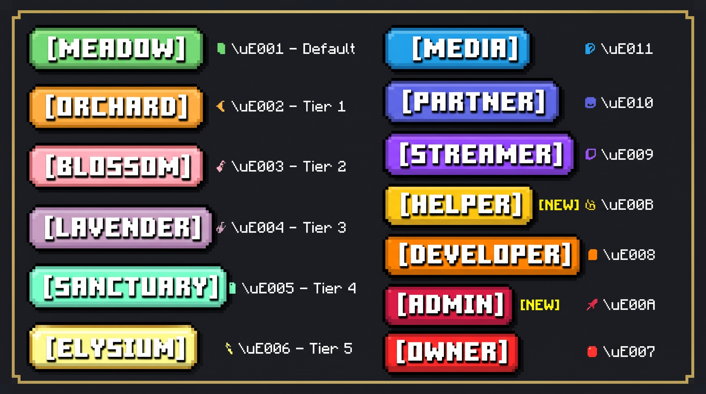

# ✨ Aspiral — Custom Rank Badges

Resource pack custom rank bergaya pixel-art untuk server **Minecraft Paper 26.3 Crossplay (Java & Bedrock via Geyser + Floodgate)**.

---

## 📦 Daftar Rank & Kode Unicode

| Tier / Kategori | Nama Rank | Hex Warna | Kode Unicode |
| :--- | :--- | :--- | :--- |
| **Default** | `MEADOW` | `#77DD77` | `\uE001` |
| **Tier 1** | `ORCHARD` | `#FFB347` | `\uE002` |
| **Tier 2** | `BLOSSOM` | `#FFB7C5` | `\uE003` |
| **Tier 3** | `LAVENDER` | `#C8A2C8` | `\uE004` |
| **Tier 4** | `SANCTUARY` | `#98FF98` | `\uE005` |
| **Tier 5** | `ELYSIUM` | `#FDFD96` | `\uE006` |
| **Staff** | `OWNER` | `#FF3333` | `\uE007` |
| **Staff** | `DEVELOPER` | `#FF8800` | `\uE008` |
| **Creator** | `STREAMER` | `#9146FF` | `\uE009` |
| **Creator** | `PARTNER` | `#5865F2` | `\uE010` |
| **Creator** | `MEDIA` | `#1DA1F2` | `\uE011` |

---

## 🚀 Cara Instalasi

### 1. Minecraft Java Edition (Server Side)
Tambahkan baris berikut ke dalam `server.properties`:
properties
resource-pack=[https://github.com/dzull2253-bit/ranks-custom-minecraft/releases/download/aspiral.v1.0/CustomRanks-Java.zip](https://github.com/dzull2253-bit/ranks-custom-minecraft/releases/download/aspiral.v1.0/CustomRanks-Java.zip)
resource-pack-sha1=<ISI_SHA1_DISINI>
require-resource-pack=true

### 2. Minecraft Bedrock editions (geyser spingot):
Tambahkan file CustomRanks-Bedrock.mcpack ke dalam folder 
/plugins/geyser-spingot/pack/CustomRanks-Bedrock.mcpack.
